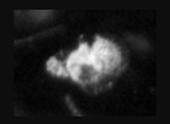

# Plankton Image Classification

Ein Machine-Learning-Projekt zur Klassifikation verschiedener Plankton-Arten anhand von Mikroskopbildern.  
Besondere Herausforderung: **stark unbalancierte Klassenverteilung**.

Das Projekt untersucht verschiedene Machine-Learning-Ansätze zur Klassifikation von Planktonbildern.

---

## Inhaltsverzeichnis

- [Beschreibung](#beschreibung)
- [Dataset](#dataset)
- [Dataset License](#dataset-license)
- [Beispielbild](#beispielbild)
- [Projektstruktur](#projektstruktur)
- [Installation](#installation)
- [Usage](#usage)
- [Modelle](#modelle)
- [Umgang mit Class Imbalance](#umgang-mit-class-imbalance)
- [Evaluation](#evaluation)
- [Autor](#autor)
- [Project Status](#project-status)

---

## Beschreibung

Ziel des Projekts ist die Entwicklung eines Modells zur **möglichst guten Klassifikation der Plankton-Bilder** mithilfe verschiedener Machine-Learning-Ansätze:

- Decision Tree & verwandte Modelle (Random Forest, Gradient Boosting)
- Feedforward Neural Network (FFNN)
- Convolutional Neural Network (CNN)

Die Modelle werden anhand gängiger Metriken evaluiert und verglichen.

---

## Dataset

Das Datenset enthält:

- Gelabelte Bilder verschiedener Plankton-Arten
- Schwarz-Weiß-Bilder mit unterschiedlichen Auflösungen
- Stark **unbalancierte** Klassenverteilung

Der Datensatz wurde für dieses Projekt von meinem Professor zur Verfügung gestellt
und liegt ausschließlich lokal vor. Er wird aus Datenschutz-, Größen- und
Lizenzgründen nicht im Repository gespeichert.
Lege die lokal heruntergeladenen Daten unter folgendem Pfad ab:
```

./data/Plankton-Bilder/
```

### Dataset License

Die Nutzungsrechte des Datensatzes ergeben sich aus der ursprünglichen Bereitstellung
durch den Professor. Dieses Repository enthält ausschließlich den von Maximilian
Hildebrand erstellten Code und die Dokumentation und überträgt keine Rechte an den
verwendeten Bildern.

---

## Beispielbild

Ein exemplarisches Plankton-Bild:



---

## Projektstruktur

```plaintext
📦 plankton-image-classification
 ┣ 📂 data/                 # Lokale Bilddaten (nicht im Repo)
 ┣ 📂 notebooks/            # Jupyter Notebooks (EDA, Experimente)
 ┣ 📂 models/               # Gespeicherte Modelle
 ┣ 📄 requirements.txt
 ┣ 📄 .gitignore
 ┗ 📄 README.md
```

---

## Installation

```bash
git clone <repository-url>
cd plankton-image-classification
pip install -r requirements.txt
```

---

## Usage

Die Notebooks können mit Jupyter oder einer kompatiblen Entwicklungsumgebung geöffnet
und schrittweise ausgeführt werden. Die Daten- und Ausgabepfade sollten bei Bedarf
an die lokale Umgebung angepasst werden.

Empfohlene Reihenfolge:

1. `00_Datenbeschreibung.ipynb`
2. `01_preprocessing.ipynb`
3. `02_decision_tree.ipynb` und `03_knn.ipynb`
4. `04_ffnn.ipynb` und `05_cnn.ipynb`
5. `06_Modellvergleich.ipynb`

## Modelle

### Klassische ML-Modelle

- Decision Tree
- Random Forest
- Gradient Boosting

### Neuronale Netze

- **FFNN**: Pixel, Flattening und Dense Layers
- **CNN**: Convolution, Pooling, Dense Layers und Softmax

## Umgang mit Class Imbalance

Da die Klassen unterschiedlich stark vertreten sind, werden verschiedene Verfahren
auf Daten- und Algorithmenebene untersucht:

### Data-Level

- Oversampling
- Undersampling
- SMOTE
- Data Augmentation

### Algorithm-Level

- Class Weights
- Weighted Loss
- Focal Loss (für CNN)

---

## Evaluation

Für alle Modelle werden folgende Metriken berechnet:

- Accuracy
- Precision
- Recall
- F1-Score
- Confusion Matrix
- ROC/AUC (optional)

Zusätzlich erfolgt ein Vergleich aller Modelle, um das beste Modell zu bestimmen.

---

## Autor

Maximilian Hildebrand

## Project Status

Aktiv in Entwicklung. Datensätze, trainierte Modelle und lokale Ausgaben sind aus
Datenschutz-, Größen- und Reproduzierbarkeitsgründen nicht Bestandteil des Repositories.
Der Code steht unter der MIT-Lizenz; für die Bilddaten gelten die Bedingungen ihrer
jeweiligen Originalquelle.
